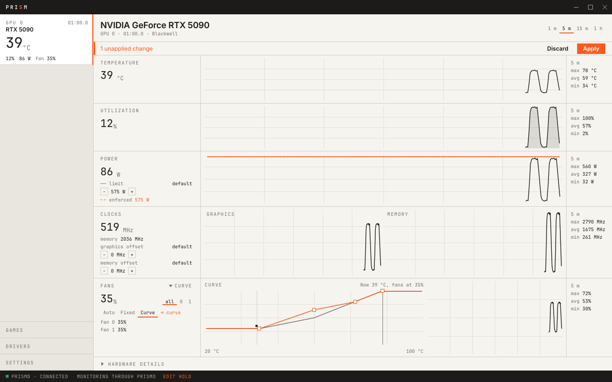
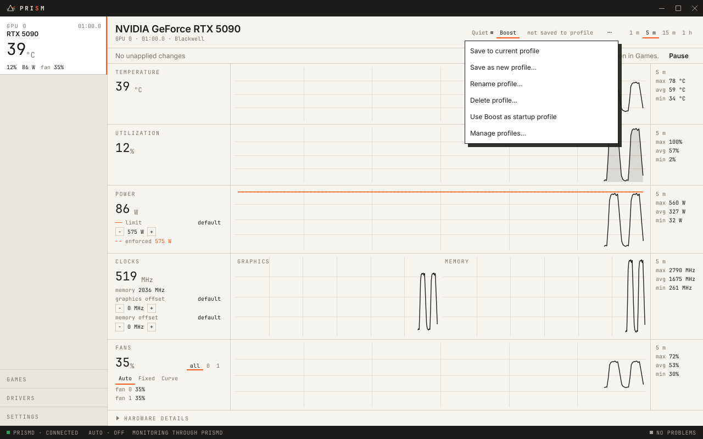
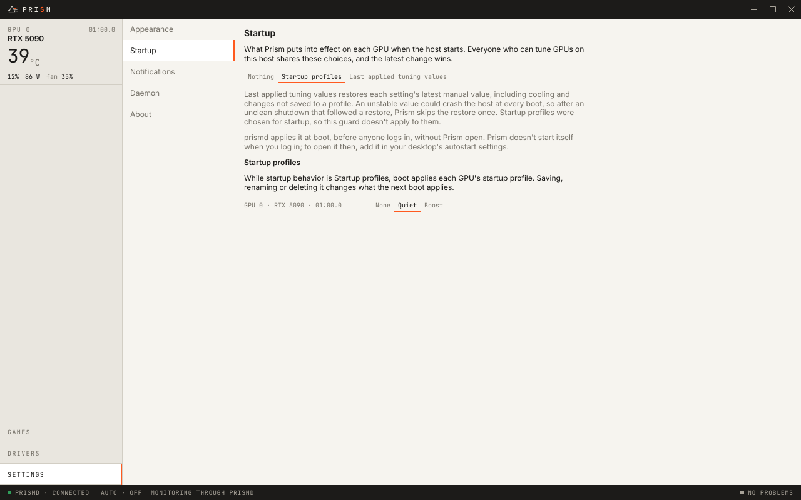
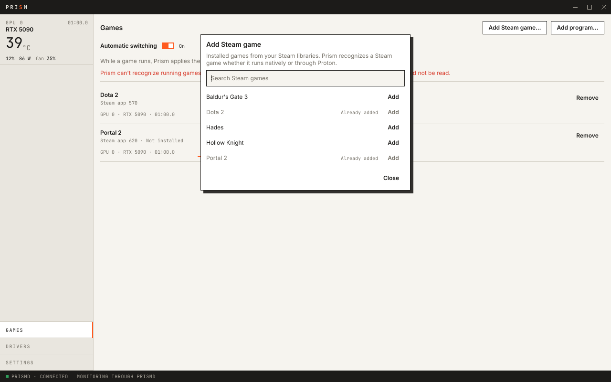
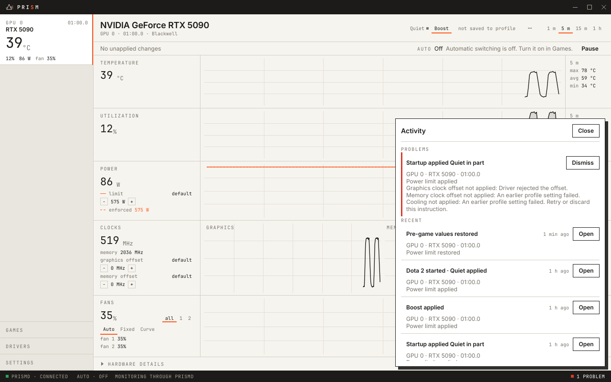
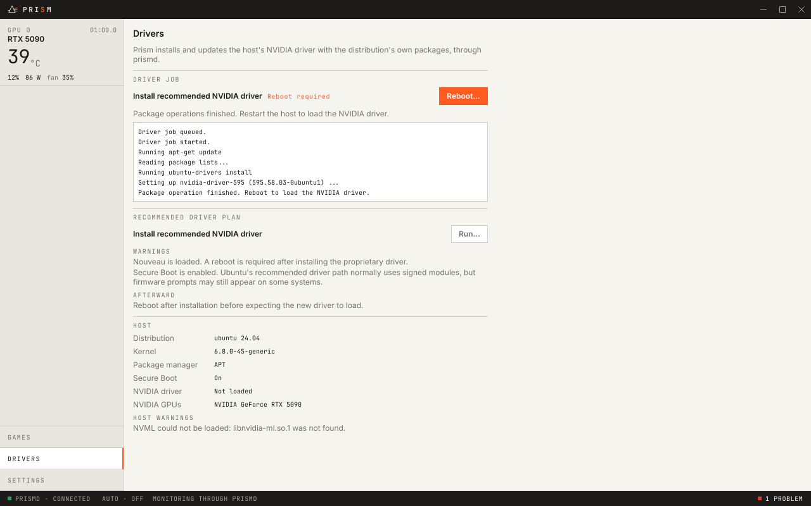
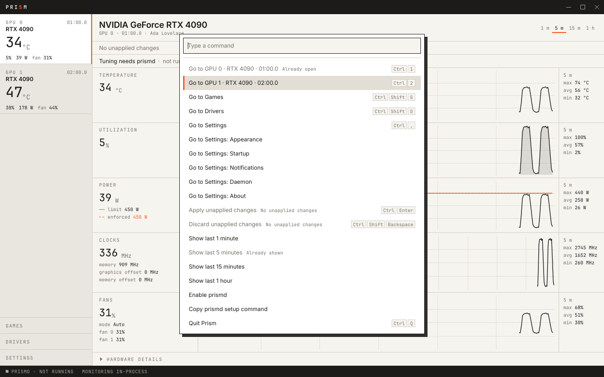
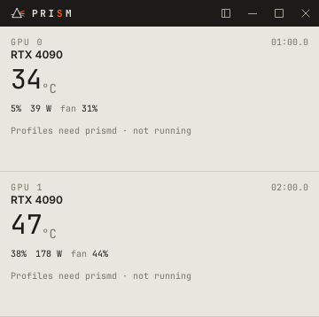
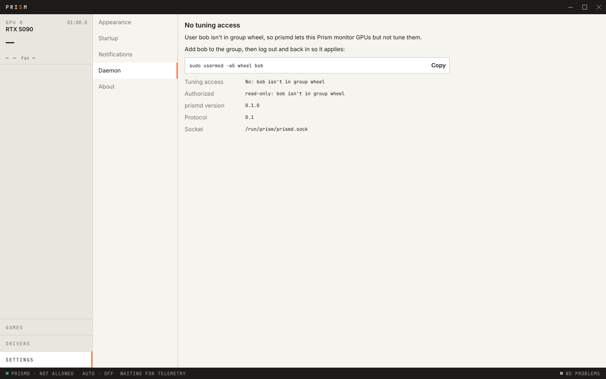

<p align="center">
  
</p>

<h1 align="center">Prism</h1>

<p align="center">
  <strong>Watch, tune and manage NVIDIA GPUs on Linux.</strong><br>
  A fast, native GPU control center for live telemetry, fan curves, tuning profiles, per-game switching and driver installs.
</p>

<p align="center">
  <a href="https://github.com/tobytaken/prism/releases/latest"></a>
  <a href="./LICENSE"></a>
  
  
</p>

<p align="center">
  <a href="#install">Install</a> ·
  <a href="#features">Features</a> ·
  <a href="#set-up-tuning">Set up tuning</a> ·
  <a href="#tips">Tips</a> ·
  <a href="#troubleshooting">Troubleshooting</a> ·
  <a href="./CONTRIBUTING.md">Contributing</a>
</p>

<picture>
  <source media="(prefers-color-scheme: dark)" srcset="crates/prism/tests/screenshots/workspace-fan-curve-dark.png">
  
</picture>

## What is Prism?

Prism shows what your NVIDIA GPUs are doing and lets you change how they behave. You can watch each GPU's temperature, utilization, power, clocks and fans live and over time, set power limits and clock offsets, draw fan curves, save it all as profiles, and have the right profile applied when a game starts.

Prism is two programs:

- **`prism`**, the app. It reads your GPUs directly, so **monitoring works on its own**, with nothing else installed.
- **`prismd`**, a small system service. It makes every change to your GPUs, checks that you're allowed to make it, and keeps your fan curves and startup profiles running when the app is closed. **Tuning needs `prismd`.**

## Features

### Live telemetry

Each GPU gets a workspace with five tracks: **temperature, utilization, power, clocks and fans**. Each track shows the current value, a chart over the last 1, 5 or 15 minutes or 1 hour, and that window's min, max and average. The sidebar keeps every GPU's vitals in view. **Hardware details** lists the GPU's model, architecture, driver, VBIOS, memory and PCIe link, and the range each tuning control supports.

### Tuning and fan curves

Set the **power limit** and **graphics and memory clock offsets**, and run fans on **Auto**, at a **fixed speed** or along a **curve** you drag into shape. Fans can share one setting or each have their own. Edits stay unapplied until you press **Apply**. Each value is checked against the GPU's own limits, and Prism never clamps a value silently.

### Profiles and startup

<table>
  <tr>
    <td width="50%">
      <picture>
        <source media="(prefers-color-scheme: dark)" srcset="crates/prism/tests/screenshots/profile-menu-dark.png">
        
      </picture>
    </td>
    <td width="50%">
      <picture>
        <source media="(prefers-color-scheme: dark)" srcset="crates/prism/tests/screenshots/settings-startup-dark.png">
        
      </picture>
    </td>
  </tr>
</table>

Save tuning as named profiles such as *Quiet* or *Boost*, one set per GPU, and switch between them in one click. Under **Settings → Startup**, choose what happens at boot: nothing (the default), each GPU's **startup profile**, or the **last applied tuning values**. `prismd` applies them before anyone logs in, without the app running. In case an unstable value crashes the host, a boot that follows an unclean shutdown after a restore skips the restore once.

### Games

<table>
  <tr>
    <td width="50%">
      <picture>
        <source media="(prefers-color-scheme: dark)" srcset="crates/prism/tests/screenshots/add-steam-game-dark.png">
        
      </picture>
    </td>
    <td width="50%">
      <picture>
        <source media="(prefers-color-scheme: dark)" srcset="crates/prism/tests/screenshots/activity-dark.png">
        
      </picture>
    </td>
  </tr>
</table>

Link your Steam games, or any other program, to a profile on each GPU. With **automatic switching** on, `prismd` applies the linked profile while the game runs and restores your previous values when it exits. **Activity** keeps a log of what was applied, switched and restored, and of anything that failed.

> [!WARNING]
> **Automatic switching is experimental.** Linking games works, but recognizing running games hasn't passed validation on every kind of Steam install yet, Flatpak Steam in particular. Follow [#49](https://github.com/tobytaken/prism/issues/49) for progress.

### Drivers

<table>
  <tr>
    <td width="50%">
      <picture>
        <source media="(prefers-color-scheme: dark)" srcset="crates/prism/tests/screenshots/drivers-reboot-required-dark.png">
        
      </picture>
    </td>
    <td width="50%">
      <picture>
        <source media="(prefers-color-scheme: dark)" srcset="crates/prism/tests/screenshots/command-palette-dark.png">
        
      </picture>
    </td>
  </tr>
</table>

On **Ubuntu** and **Fedora**, the Drivers page detects your host and its NVIDIA driver, then installs or updates it with your distribution's own packages. Before it starts, it warns you about Secure Boot, Nouveau and any reboot the install needs.

### Built for the keyboard, and for small windows

Press <kbd>Ctrl</kbd>+<kbd>K</kbd> for a **command palette** that reaches every page, setting and action. **Compact mode** shrinks Prism to a small window of live GPU vitals for a corner of your screen. Prism follows your desktop's **light or dark** appearance, and shows a desktop notification when something needs your attention.

<p align="center">
  <picture>
    <source media="(prefers-color-scheme: dark)" srcset="crates/prism/tests/screenshots/compact-mode-two-gpus-dark.png">
    
  </picture>
</p>

## Requirements

- An **NVIDIA GPU** with NVIDIA's proprietary driver. Prism reads and tunes GPUs through NVML (`libnvidia-ml.so.1`), which ships with the driver. If you don't have the driver yet, Prism's Drivers page can install it on Ubuntu and Fedora.
- **Linux on x86_64**, with glibc 2.28 or newer: Ubuntu 22.04+, Debian 12+, Fedora, RHEL/AlmaLinux/Rocky 8+, Arch and their derivatives.
- **systemd**, to run `prismd` for tuning.

## Install

Download the packages for your distribution from the [**latest release**](https://github.com/tobytaken/prism/releases/latest). The app is `prism-gpu` and the daemon is `prismd`. Install both if you want to tune.

| Your system | App | Daemon (for tuning) |
| --- | --- | --- |
| Ubuntu, Debian | `prism-gpu_…_amd64.deb` | `prismd_…_amd64.deb` |
| Fedora, RHEL, AlmaLinux, Rocky | `prism-gpu-….x86_64.rpm` | `prismd-….x86_64.rpm` |
| Arch | `prism-gpu-aur-….tar.gz` (builds both) | |
| Any distribution | `io.github.tobytaken.Prism.flatpak` or `Prism-x86_64.AppImage` | the deb, rpm or Arch `prismd` |

### Ubuntu and Debian

From the folder you downloaded the packages to:

```bash
sudo apt install ./prism-gpu_*_amd64.deb ./prismd_*_amd64.deb
```

The deb starts `prismd` straight away and at every boot.

### Fedora, RHEL, AlmaLinux and Rocky

```bash
sudo dnf install ./prism-gpu-*.x86_64.rpm ./prismd-*.x86_64.rpm
sudo systemctl enable --now prismd.service
```

The rpm follows your distribution's service presets, which on Fedora leave `prismd` off until you enable it.

### Arch

The release includes a split `PKGBUILD` that builds both packages from source:

```bash
tar -xzf prism-gpu-aur-*.tar.gz
makepkg -si
sudo systemctl enable --now prismd.service
```

### Flatpak

```bash
flatpak install --user ./io.github.tobytaken.Prism.flatpak
```

The bundle fetches its runtime from Flathub. It holds only the app, so for tuning, install `prismd` on the host from the deb, rpm or Arch package above. The Flatpak also needs Flathub's `org.freedesktop.Platform.GL.nvidia` extension for your exact driver version, which `flatpak update` installs.

### AppImage

```bash
chmod +x Prism-x86_64.AppImage
./Prism-x86_64.AppImage
```

The AppImage bundles no libraries, so GL, Vulkan and the NVIDIA libraries come from your system. Like the Flatpak, it needs a host `prismd` to tune.

Every release lists the SHA-256 checksums of its files in `SHA256SUMS`. Check your downloads with `sha256sum --check --ignore-missing SHA256SUMS`.

## Set up tuning

Prism's status bar always shows whether it can tune. When it can't, for example **`PRISMD · NOT RUNNING`** or **`PRISMD · NOT ALLOWED`**, click it to open **Settings → Daemon**. That page explains what's wrong and gives you the exact fix, with a **Copy** button for each command. It shows the install command for your distribution, **Enable prismd** when the daemon isn't running, **Restart prismd** and the `journalctl` command when it failed, and the command that adds you to the right group.

<picture>
  <source media="(prefers-color-scheme: dark)" srcset="crates/prism/tests/screenshots/daemon-not-allowed-dark.png">
  
</picture>

Anyone on the computer can open Prism and monitor GPUs. **Changing** tuning, profiles, games, startup behavior or drivers is limited to root, members of the admin group, and one optional extra user, both of which `/etc/prism/prismd.toml` can set:

```toml
# admin_group = "wheel"
# admin_user = "your-username"
```

Without `admin_group`, prismd uses `wheel`, then `sudo`, then `root`, whichever exists first: `wheel` on Fedora and Arch, `sudo` on Debian and Ubuntu. To let yourself tune, either join that group, then log out and back in:

```bash
sudo usermod -aG wheel "$USER"   # sudo on Debian and Ubuntu
```

Or set `admin_user` to your username and restart the daemon:

```bash
sudo systemctl restart prismd
```

[docs/prismd.md](./docs/prismd.md) describes everything the daemon does, and where it keeps its state.

## Tips

| Shortcut | Action |
| --- | --- |
| <kbd>Ctrl</kbd>+<kbd>K</kbd> | Command palette |
| <kbd>Ctrl</kbd>+<kbd>1</kbd> … <kbd>9</kbd> | Go to GPU 0 to 8 |
| <kbd>Ctrl</kbd>+<kbd>Enter</kbd> | Apply unapplied changes |
| <kbd>Ctrl</kbd>+<kbd>Shift</kbd>+<kbd>Backspace</kbd> | Discard unapplied changes |
| <kbd>Ctrl</kbd>+<kbd>Shift</kbd>+<kbd>M</kbd> | Toggle compact mode |
| <kbd>Ctrl</kbd>+<kbd>Shift</kbd>+<kbd>A</kbd> | Open Activity |
| <kbd>Ctrl</kbd>+<kbd>Shift</kbd>+<kbd>G</kbd> / <kbd>D</kbd> | Go to Games / Drivers |
| <kbd>Ctrl</kbd>+<kbd>,</kbd> | Go to Settings |
| <kbd>Ctrl</kbd>+<kbd>Q</kbd> | Quit |

- **Closing the window quits Prism.** Your fan curves, startup profiles and game switching keep running in `prismd`. To open Prism when you log in, add it to your desktop's autostart settings.
- **Light or dark** follows your desktop. To pin one, choose it under **Settings → Appearance**.

## Troubleshooting

<details>
<summary><strong>Prism shows no GPUs, or says NVML couldn't be loaded</strong></summary>

Prism needs NVIDIA's proprietary driver, loaded. Check with `nvidia-smi`. If the driver isn't installed, use the **Drivers** page on Ubuntu or Fedora, or your distribution's instructions, then reboot. The open-source Nouveau driver isn't supported.

</details>

<details>
<summary><strong>The Flatpak can't see the GPU, or has no graphics acceleration</strong></summary>

The Flatpak needs the `org.freedesktop.Platform.GL.nvidia-…` extension for your exact host driver version. Run `flatpak update` after every driver update, and check it's there with `flatpak list --runtime | grep nvidia`.

</details>

<details>
<summary><strong>prismd won't start</strong></summary>

**Settings → Daemon** shows systemd's result. For the full log, run:

```bash
systemctl status prismd
journalctl -u prismd
```

</details>

<details>
<summary><strong>A tuning change was rejected</strong></summary>

Prism never clamps values. If the driver rejects a value, Prism says which setting failed and what happened to the rest. **Activity** (<kbd>Ctrl</kbd>+<kbd>Shift</kbd>+<kbd>A</kbd>) lists every failure, including those from startup and game switching.

</details>

Found a bug? [Open an issue](https://github.com/tobytaken/prism/issues), with your distribution, GPU, driver version (`nvidia-smi`) and how you installed Prism.

## Contributing

Prism is written in Rust, with a [Slint](https://slint.dev) GUI. [CONTRIBUTING.md](./CONTRIBUTING.md) covers the architecture, building and testing, running Prism on simulated GPUs, packaging and releases. The design decisions are recorded in [`docs/adr`](./docs/adr), and the project's vocabulary in [`CONTEXT.md`](./CONTEXT.md).

## License

Prism is free software, licensed under the GNU General Public License, version 3 or later (`GPL-3.0-or-later`). See [`LICENSE`](./LICENSE), and [`THIRD-PARTY-LICENSES`](./THIRD-PARTY-LICENSES) for its dependencies.
